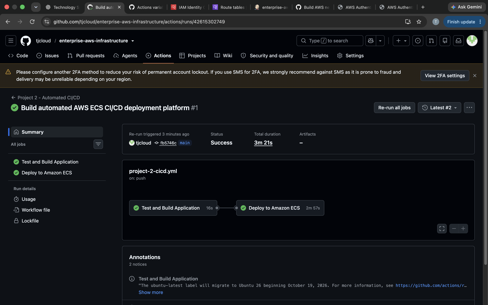
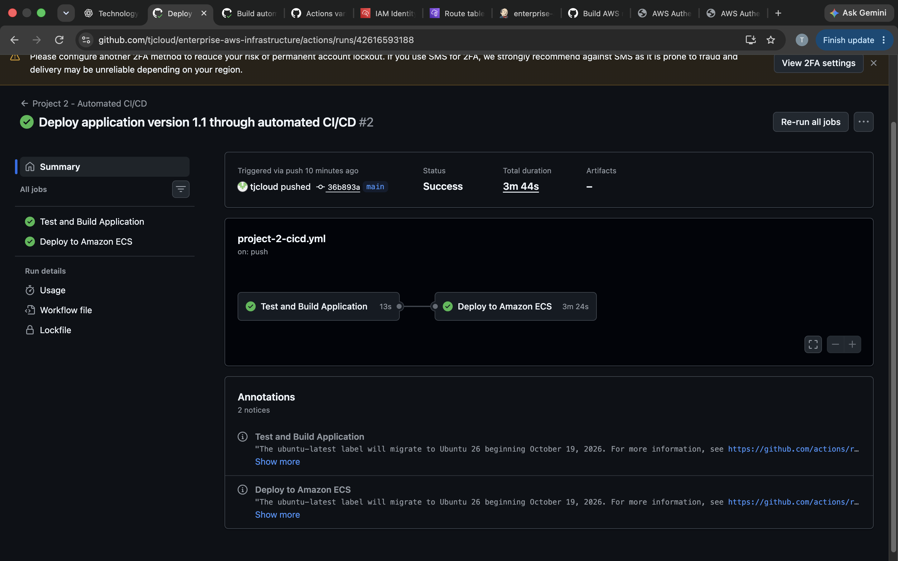
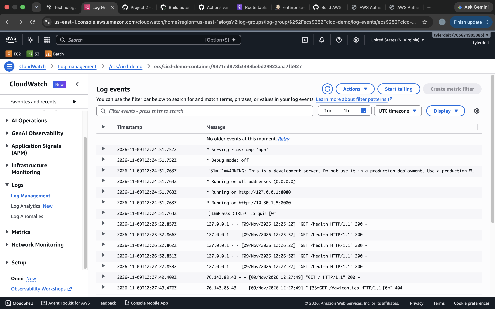

# Automated AWS CI/CD Deployment Platform

## Project Overview

This project demonstrates an automated CI/CD pipeline that tests, packages,
and deploys a Python web application to Amazon ECS using GitHub Actions.

A code change pushed to the main branch triggers automated testing,
Docker image creation, Amazon ECR image storage, and ECS deployment.

## Architecture

GitHub Repository
       |
       v
GitHub Actions
       |
       v
Python Automated Tests
       |
       v
Docker Image Build
       |
       v
GitHub OIDC Authentication
       |
       v
Amazon ECR
       |
       v
Amazon ECS Fargate
       |
       v
Amazon CloudWatch Logs

## Technologies Used

- AWS
- Amazon VPC
- Amazon ECS Fargate
- Amazon ECR
- AWS IAM
- GitHub Actions
- GitHub OIDC
- Docker
- Python
- Flask
- Pytest
- Terraform
- Amazon CloudWatch

## Application Features

- Python Flask web application
- HTTP home endpoint
- Application health endpoint
- Automated application tests
- Docker containerization
- Non-root container execution
- ECS container health checks

## CI/CD Pipeline

The GitHub Actions workflow performs the following operations:

1. Checks out the GitHub repository.
2. Installs Python dependencies.
3. Runs automated application tests.
4. Builds the Docker image.
5. Authenticates to AWS using GitHub OIDC.
6. Pushes the Docker image to Amazon ECR.
7. Registers a new ECS task definition.
8. Updates the ECS service.
9. Waits for ECS deployment stability.
10. Retrieves the application's public IP address.

## AWS Infrastructure

Terraform provisions:

- VPC and public subnet
- Internet Gateway and route table
- Application security group
- Amazon ECR repository
- Amazon ECS cluster and service
- Fargate task definition
- IAM task execution role
- GitHub OIDC identity provider
- GitHub Actions deployment role
- CloudWatch log group

The ECS service was configured with zero desired tasks initially.
A task was started for deployment testing and scaled back to zero afterward.

## Deployment Verification

Two successful GitHub Actions deployments were completed.

### Version 1.0

The original application was deployed through GitHub Actions.

### Version 1.1

The application message and version were updated in GitHub.
The new commit automatically triggered another pipeline run.

The deployed application returned:

    {
      "message": "Version 1.1 deployed automatically through GitHub Actions",
      "version": "1.1.0"
    }

The health endpoint returned:

    {
      "status": "healthy"
    }

## Security

- GitHub OIDC authentication instead of permanent AWS access keys.
- IAM role-based deployment permissions.
- Application inbound traffic restricted to an approved IP address.
- Container runs as a non-root user.
- ECS task execution permissions separated from deployment permissions.

## Infrastructure as Code

AWS infrastructure is defined in Terraform under:

    terraform/

The Terraform configuration can be initialized, validated, planned,
applied, and destroyed independently of the application code.

## Cost Management

This project was deployed as a temporary AWS portfolio lab.

After testing, the ECS service was scaled to zero. All 18 Terraform-managed AWS resources were destroyed, and remaining ECS task-definition revisions were deregistered.

No project infrastructure was left running after testing.

## Key Skills Demonstrated

- CI/CD pipeline development
- Python application testing
- Docker image creation
- AWS container deployment
- Amazon ECR and ECS
- GitHub Actions automation
- GitHub OIDC authentication
- IAM permissions
- Terraform infrastructure automation
- CloudWatch logging
- Deployment verification
- AWS resource cleanup

## Deployment Evidence

### Initial AWS deployment — Version 1.0

### Automated AWS deployment — Version 1.1

### CloudWatch application logs

