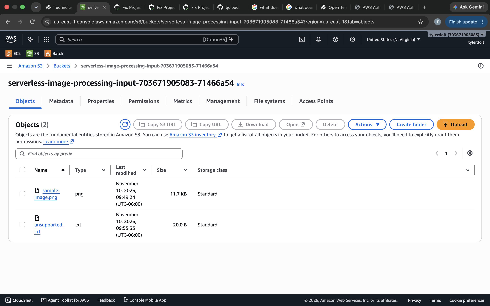
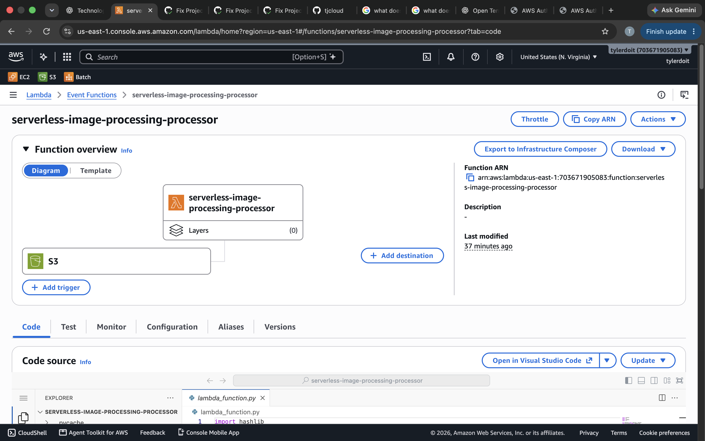
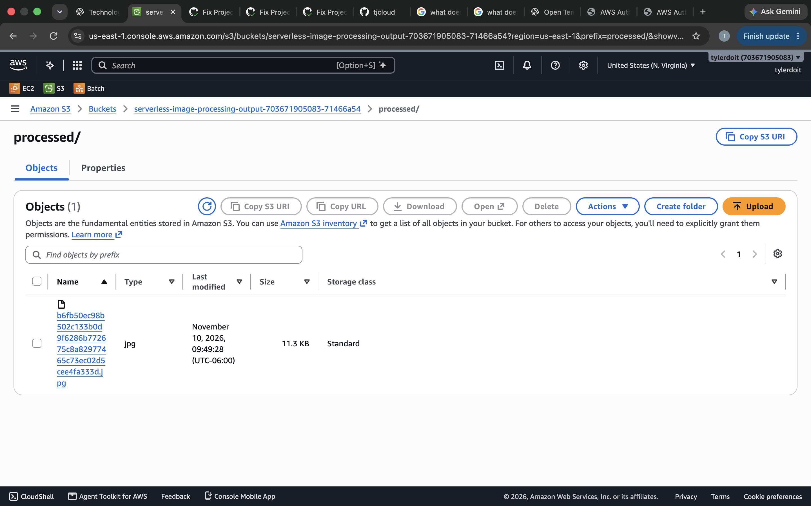
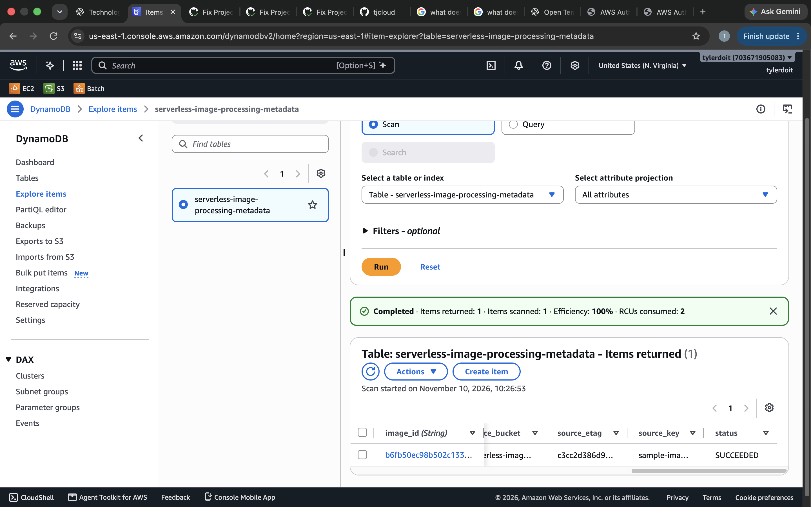
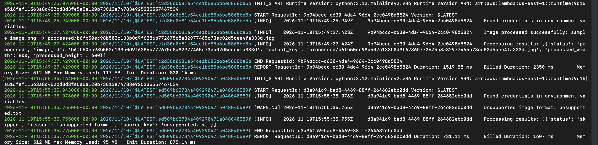
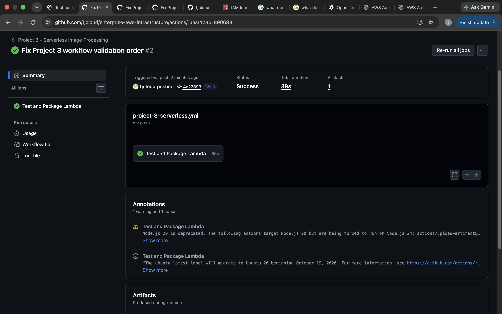
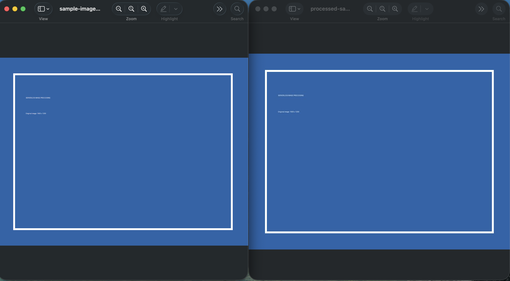

# Serverless Event-Driven Image Processing on AWS

## Project Overview

This project demonstrates a serverless, event-driven image-processing application built using AWS Lambda, Amazon S3, Amazon DynamoDB, Python, and Terraform.

When a user uploads an image to an Amazon S3 input bucket, an S3 event notification automatically triggers an AWS Lambda function.

The Lambda function retrieves the original image, processes it using Python and Pillow, resizes it, converts it to JPEG, uploads the processed image to a separate S3 bucket, and stores processing metadata in DynamoDB.

The application also uses Amazon CloudWatch for execution logs and error monitoring.

## Architecture

```text
                 IMAGE UPLOAD
                      |
                      v
              AMAZON S3 INPUT
                      |
                      v
              S3 EVENT NOTIFICATION
                      |
                      v
                AWS LAMBDA
                 PYTHON 3.12
                      |
               IMAGE PROCESSING
                      |
              +-------+-------+
              |               |
              v               v
         AMAZON S3       AMAZON DYNAMODB
         OUTPUT          IMAGE METADATA
              |
              v
         PROCESSED JPEG

              CLOUDWATCH
          EXECUTION LOGS
```

The project uses separate input and output S3 buckets to prevent recursive Lambda invocations.

## Deployment Evidence

### 1. Original Image in Amazon S3



### 2. AWS Lambda Configuration



### 3. Processed Image in Amazon S3



### 4. DynamoDB Image Metadata



### 5. CloudWatch Execution Logs



### 6. GitHub Actions Pipeline



### 7. Original vs. Processed Image



## Technologies Used

| Technology | Purpose |
|---|---|
| AWS Lambda | Serverless image processing |
| Amazon S3 | Original and processed image storage |
| Amazon DynamoDB | Image metadata storage |
| AWS IAM | Identity and access management |
| Amazon CloudWatch | Application logging and monitoring |
| Python 3.12 | Application development |
| Pillow | Image manipulation and conversion |
| Boto3 | Python AWS SDK |
| Pytest | Automated application testing |
| Terraform | Infrastructure as Code |
| GitHub Actions | Automated testing and packaging |

## Image Processing Features

The Python application implements the following functionality:

- Accepts JPEG and PNG images.
- Retrieves uploaded images from Amazon S3.
- Corrects image orientation using EXIF information.
- Resizes images to a maximum dimension of 800 × 800 pixels.
- Maintains original image proportions.
- Handles PNG transparency by converting images to RGB.
- Converts processed images to JPEG.
- Uploads processed images to the output S3 bucket.
- Generates deterministic image identifiers.
- Stores processing metadata in DynamoDB.
- Detects unsupported file formats.
- Skips invalid or unreadable images.

## Demonstrated Processing Results

The original test image measured:

- Original format: PNG
- Original dimensions: 1600 × 1200

The processed image measured:

- Processed format: JPEG
- Processed dimensions: 800 × 600

The DynamoDB record confirmed:

- Original width: 1600
- Original height: 1200
- Processed width: 800
- Processed height: 600
- Processing status: SUCCEEDED

An additional test uploaded an unsupported `.txt` file.

Lambda correctly identified the unsupported format and skipped processing without crashing.

## AWS Infrastructure

Terraform provisions and manages the AWS resources required by the application.

### Amazon S3

Two separate buckets are created:

**Input bucket**
- Stores original uploaded images.
- Blocks public access.
- Uses server-side encryption.
- Automatically triggers Lambda when an object is created.

**Output bucket**
- Stores resized JPEG images.
- Blocks public access.
- Uses server-side encryption.

Both buckets have seven-day object lifecycle expiration policies.

### AWS Lambda

The Lambda function runs:

- Runtime: Python 3.12
- Architecture: x86_64
- Memory: 512 MB
- Timeout: 30 seconds

The function handles image retrieval, image processing, output storage, and metadata creation.

### Amazon DynamoDB

The metadata table uses on-demand billing and a string partition key named `image_id`.

It records:
- Image identifier.
- Original bucket and filename.
- Processed bucket and filename.
- Original dimensions.
- Processed dimensions.
- Content type.
- Processing status.
- Source ETag.
- Processing timestamp.

### AWS IAM

Lambda uses a dedicated execution role with restricted permissions.

The role permits:
- Reading objects from the input bucket.
- Writing objects to the output bucket.
- Writing records to the project DynamoDB table.
- Creating log streams and writing CloudWatch events.

### Amazon CloudWatch

Lambda execution logs are stored in a dedicated log group with seven-day retention.

Logs demonstrate successful processing, unsupported-file handling, and execution information.

## Infrastructure as Code

Terraform configuration is stored in:

```text
terraform/
├── provider.tf
├── variables.tf
├── main.tf
├── outputs.tf
└── terraform.tfvars.example
```

Terraform manages the S3 buckets, security configurations, lifecycle policies, DynamoDB table, Lambda function, IAM role, CloudWatch log group, and S3 event notification.

## Automated Testing

Four automated tests were implemented using Pytest.

| Test | Result |
|---|---|
| JPEG image resizing | Passed |
| PNG transparency conversion | Passed |
| Unsupported file handling | Passed |
| Invalid image handling | Passed |

The tests use simulated S3 and DynamoDB clients to verify application behavior without requiring live AWS requests.

## GitHub Actions Workflow

The GitHub Actions workflow automatically:

1. Checks out the repository.
2. Sets up Python 3.12.
3. Installs application and testing dependencies.
4. Runs the automated test suite.
5. Checks Terraform formatting.
6. Initializes Terraform without deploying infrastructure.
7. Validates Terraform configuration.
8. Builds a Linux-compatible Lambda deployment ZIP.
9. Uploads the Lambda package as a workflow artifact.

The workflow provides automated testing and packaging. AWS infrastructure deployment is managed separately through Terraform.

## Security Practices

- S3 public access is blocked.
- S3 buckets use server-side encryption.
- Lambda has a dedicated IAM execution role.
- S3 read and write permissions are restricted to the appropriate buckets.
- DynamoDB access is restricted to the project table.
- CloudWatch log retention is configured.
- Separate input and output buckets prevent recursive image-processing events.

## Cost Management

This project uses serverless AWS services rather than continuously running EC2 instances or containers.

Potential AWS charges include:
- S3 storage and requests.
- Lambda invocations and execution duration.
- DynamoDB requests and storage.
- CloudWatch log ingestion and storage.

The project uses on-demand DynamoDB billing, seven-day S3 lifecycle expiration, and seven-day CloudWatch retention.

The AWS infrastructure is intended for temporary portfolio demonstrations and will be destroyed after testing and evidence collection.

## Skills Demonstrated

- Serverless AWS architecture.
- Event-driven application development.
- AWS Lambda development.
- S3 object storage and event notifications.
- Python image processing.
- DynamoDB operations.
- IAM least-privilege permissions.
- CloudWatch monitoring and logging.
- Terraform infrastructure automation.
- Automated Python testing.
- GitHub Actions CI workflows.
- AWS deployment and resource management.

## Project Repository Structure

```text
serverless-image-processing/
│
├── app/
│   ├── __init__.py
│   └── lambda_function.py
│
├── tests/
│   └── test_lambda_function.py
│
├── samples/
│   ├── create_sample_image.py
│   ├── sample-image.png
│   └── unsupported.txt
│
├── terraform/
│   ├── provider.tf
│   ├── variables.tf
│   ├── main.tf
│   ├── outputs.tf
│   └── terraform.tfvars.example
│
├── screenshots/
│
├── build/
│
├── requirements.txt
├── requirements-dev.txt
├── .gitignore
└── README.md
```

---
## Deployment Status

Completed. The serverless image-processing application was successfully deployed and tested using AWS Lambda, Amazon S3, and DynamoDB.

Image uploads successfully triggered Lambda processing. The application resized and converted images, stored processed files in the output bucket, and recorded metadata in DynamoDB.

Unsupported file handling and all four automated Pytest cases were verified.

The GitHub Actions workflow successfully tested the application, validated Terraform configuration, and packaged the Lambda deployment ZIP.

All AWS resources were destroyed after testing to prevent ongoing resource costs.

**Project Status:** Successfully implemented and tested in AWS.
